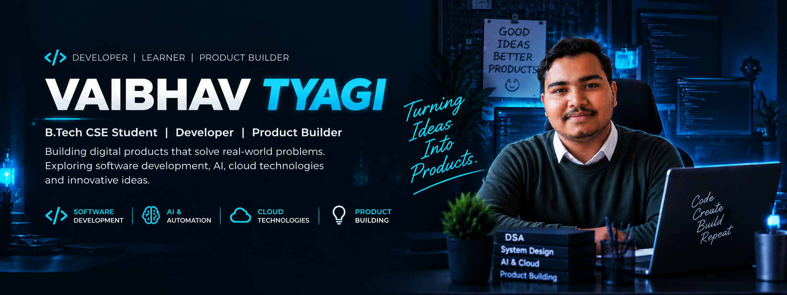

  

  

---

<h2>01 / ABOUT ME</h2>

<h1>Ideas. Built Different.</h1>

I build practical digital products that turn everyday problems into simple, useful software.

<code>01 IDEATE</code> ➜ <code>02 DESIGN</code> ➜ <code>03 BUILD</code> ➜ <code>04 TEST</code> ➜ <code>05 SHIP</code>

<h3>💻 Software Development</h3>

Building useful digital products from idea to deployment.

<h3>🤖 AI & Cloud</h3>

Exploring AI-powered applications, automation and cloud systems.

<h3>🧠 Problem Solving</h3>

Improving programming fundamentals, DSA and logical thinking.

<h3>🚀 Product Building</h3>

Turning ideas into real products.

---

<h2>02 / BEYOND THE CODE</h2>

<h1>More Than a Job Title.</h1>

🎓 <b>B.Tech CSE</b>

Computer Science & Engineering student.

💻 <b>Developer</b>

Building digital products and utilities.

🚀 <b>Builder</b>

Turning ideas into working products.

🧠 <b>Learner</b>

Always exploring new technology.

<h3>CURRENT FOCUS</h3>

<code>DSA</code> &nbsp;
<code>AI</code> &nbsp;
<code>CLOUD</code> &nbsp;
<code>PRODUCT BUILDING</code>

---

<h2>03 / SELECTED WORK</h2>

<h1>Things I'm Building.</h1>

A collection of digital products, tools and experiments.

 

<h2>🧾 PakkaBill</h2>
<h3>GST BILLING & INVENTORY</h3>

Modern billing and inventory management platform for businesses.

<code>GST</code> <code>Billing</code> <code>Business</code>

---

<h2>🏘️ PanchayatAI</h2>
<h3>SMART SOCIETY MANAGEMENT</h3>

Digital management platform for housing societies, residents and administration.

<code>AI</code> <code>Management</code> <code>Society</code>

---

<h2>🚆 MetroSetu</h2>
<h3>METRO ALL IN ONE</h3>

Transit platform bringing metro and regional transit information together.

<code>Transit</code> <code>Metro</code> <code>Travel</code>

---

<h2>🧾 InvoStudio</h2>
<h3>SMART INVOICE & BILLING PLATFORM</h3>

A modern invoice management platform to create professional invoices, manage customers, calculate GST, track payments and simplify business billing.

<code>Invoice Generator</code>
<code>GST Billing</code>
<code>PDF Invoices</code>
<code>Customer Management</code>
<code>Payment Tracking</code>
<code>Business Profile</code>
<code>Tax Calculation</code>
<code>Billing Automation</code>

---

<h2>🔳 GetAllQR</h2>
<h3>QR UTILITY PLATFORM</h3>

Tools for creating and working with QR codes.

<code>QR</code> <code>Utility</code>

---

<h2>📄 DocuFlow</h2>
<h3>PDF TOOLKIT</h3>

Browser-based document and PDF utilities for everyday workflows.

<code>PDF</code> <code>Documents</code> <code>Productivity</code>

---

<h2>🌦️ MausamSetu</h2>
<h3>LIVE WEATHER UPDATES</h3>

Weather platform designed to provide simple and useful weather information.

<code>Weather</code> <code>Forecast</code>

---

<h2>🎓 StudentToolkit</h2>
<h3>TOOLS FOR STUDENTS</h3>

Academic and student productivity utilities.

<code>Education</code> <code>Students</code> <code>Productivity</code>

---

<h2>04 / TECH STACK</h2>

<h1>Tools I Build With.</h1>

<h3>👨‍💻 Programming Languages</h3>

  

<h3>🛠️ Tools & Platforms</h3>

---

<h2>05 / CURRENTLY LEARNING</h2>

<h1>Always Learning.</h1>

<h3>🧩 Data Structures</h3>

Arrays · Linked Lists · Algorithms · Problem Solving

<h3>🗄️ Databases</h3>

Database Design · SQL · Data Management

<h3>🤖 Artificial Intelligence</h3>

AI Tools · Automation · GenAI · Intelligent Apps

---

<h2>06 / GITHUB ACTIVITY</h2>

<h1>Consistency Over Everything.</h1>

  

  

---

<h2>07 / CONTRIBUTION ACTIVITY</h2>

<h1>Building Every Day. 🚀</h1>

  

---

<h1>BUILD SOMETHING USEFUL.</h1>

<b>Learn something new. Build something real. Then make it better.</b>

 

  

  

<b>MADE WITH ❤️ IN INDIA 🇮🇳</b>

