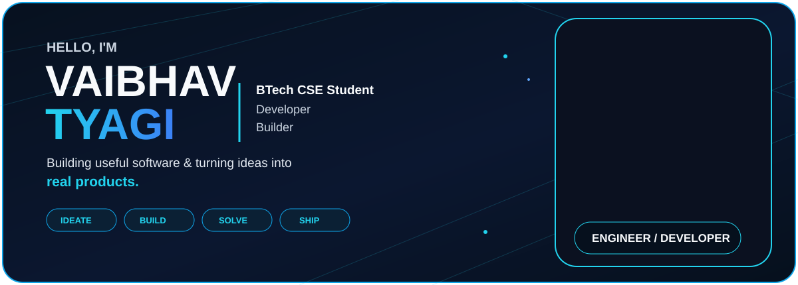

 

  

---

<h2 align="center">01 &nbsp; / &nbsp; ABOUT ME</h2>

<h1 align="center">Ideas. Built Different.</h1>

I build practical digital products that turn everyday problems into simple, useful software.

`01 IDEATE` &nbsp; ➜ &nbsp; `02 DESIGN` &nbsp; ➜ &nbsp; `03 BUILD` &nbsp; ➜ &nbsp; `04 TEST` &nbsp; ➜ &nbsp; `05 SHIP`

### 💻 Software Development
Building useful digital products from idea to deployment.

### 🤖 AI & Cloud
Exploring AI-powered applications, automation and cloud systems.

### 🧠 Problem Solving
Improving programming fundamentals, DSA and logical thinking.

### 🚀 Product Building
Turning ideas into real products.

---

<h2 align="center">02 &nbsp; / &nbsp; BEYOND THE CODE</h2>

<h1 align="center">More Than a Job Title.</h1>

- 🎓 **B.Tech CSE**  
  Computer Science & Engineering student.
- 💻 **Developer**  
  Building digital products and utilities.
- 🚀 **Builder**  
  Turning ideas into working products.
- 🧠 **Learner**  
  Always exploring new technology.

**CURRENT FOCUS**

`DSA` &nbsp; `AI` &nbsp; `CLOUD` &nbsp; `PRODUCT BUILDING`

---

<h2 align="center">03 &nbsp; / &nbsp; SELECTED WORK</h2>

<h1 align="center">Things I'm Building.</h1>

A collection of digital products, tools and experiments.

### 🧾 PakkaBill
**GST BILLING & INVENTORY**

  

Modern billing and inventory management platform for businesses.

`GST` `Billing` `Business`

---

### 🏘️ PanchayatAI
**SMART SOCIETY MANAGEMENT**

  

Digital management platform for housing societies, residents and administration.

`AI` `Management` `Society`

---

### 🚆 MetroSetu
**METRO ALL IN ONE**

Transit platform bringing metro and regional transit information together.

`Transit` `Metro` `Travel`

---

### 🧾 InvoStudio
**SMART INVOICE & BILLING PLATFORM**

A modern invoice management platform to create professional invoices, manage customers, calculate GST, track payments and simplify business billing.

`Invoice Generator` `GST Billing` `PDF Invoices` `Customer Management` `Payment Tracking` `Business Profile` `Tax Calculation` `Billing Automation`

### 🔳 GetAllQR
**QR UTILITY PLATFORM**

Tools for creating and working with QR codes.

`QR` `Utility`

---

### 📄 DocuFlow
**PDF TOOLKIT**

Browser-based document and PDF utilities for everyday workflows.

`PDF` `Documents` `Productivity`

---

### 🌦️ MausamSetu
**LIVE WEATHER UPDATES**

Weather platform designed to provide simple and useful weather information.

`Weather` `Forecast`

---

### 🎓 StudentToolkit
**TOOLS FOR STUDENTS**

Academic and student productivity utilities.

`Education` `Students` `Productivity`

---

<h2 align="center">04 &nbsp; / &nbsp; TECH STACK</h2>

<h1 align="center">Tools I Build With.</h1>

### 👨‍💻 Programming Languages

### 🛠️ Tools & Platforms

---

<h2 align="center">05 &nbsp; / &nbsp; CURRENTLY LEARNING</h2>

<h1 align="center">Always Learning.</h1>

### 🧩 Data Structures
Arrays · Linked Lists · Algorithms · Problem Solving

### 🗄️ Databases
Database Design · SQL · Data Management

### 🤖 Artificial Intelligence
AI Tools · Automation · GenAI · Intelligent Apps

---

<h2 align="center">06 &nbsp; / &nbsp; GITHUB ACTIVITY</h2>

<h1 align="center">Consistency Over Everything.</h1>

 

 

---

<h2 align="center">07 &nbsp; / &nbsp; CONTRIBUTION GRAPH</h2>

---

<h1>BUILD SOMETHING USEFUL.</h1>

**Learn something new. Build something real. Then make it better.**

 

  

  

**MADE WITH ❤️ IN INDIA**

